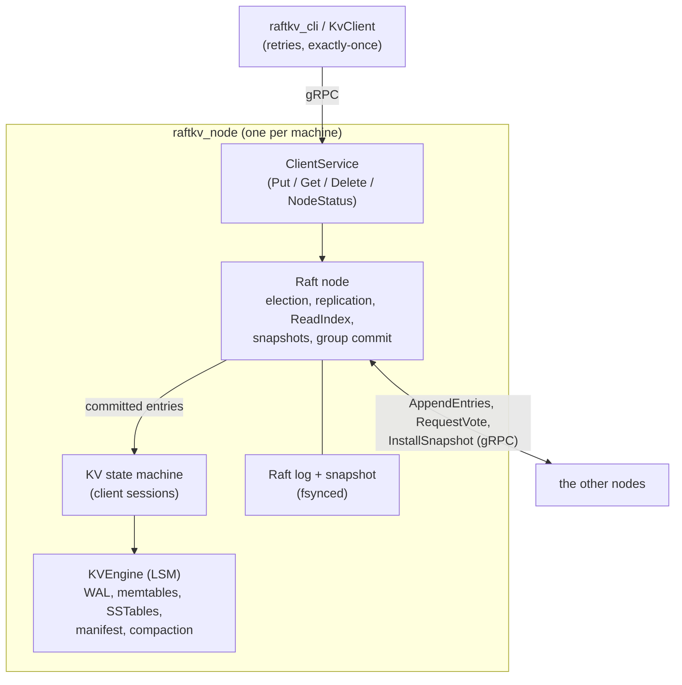

# RaftKV

A replicated key-value store written from scratch in C++17: a **Raft** consensus layer on top of an
**LSM-tree** storage engine, served over **gRPC**. Every node keeps a full copy of the data; a write
is acknowledged once a majority has it on disk, and reads are linearizable.

Built as a data structures and algorithms course project at VIT Pune. It runs on macOS and Linux.

## What it does

**Consensus (Raft)**
- Leader election with **PreVote** (a partitioned node cannot disrupt the cluster when it returns),
  log replication with conflict backtracking, and the commit rule from the Raft paper (a leader only
  counts replicas for entries of its own term).
- **Linearizable reads** with ReadIndex: a read is answered only after the leader confirms it is
  still the leader, without writing anything to the log.
- **Exactly-once writes**: each client request carries a client id and a sequence number, so a retry
  after a timeout or a leader change is applied at most once.
- **Snapshots**: the log is compacted once it grows past a threshold, and a node that has fallen
  behind the compacted log is sent the leader's snapshot in chunks.
- **Group commit**: concurrent proposals share one log write and one fsync, with an adaptive batching
  delay so that batching survives slow thread wake-ups.

**Storage (LSM tree)**
- A concurrent **skip-list memtable** behind a checksummed **write-ahead log**.
- Immutable **SSTables** with per-block checksums and **bloom filters**, flushed in the background.
- A **tiered compaction policy** that merges small new tables instead of rewriting big old ones, and
  drops tombstones only when that is safe.
- An atomically replaced **manifest** recording the live tables. Every step of flush, compaction and
  snapshot install is crash-safe, including a manifest write that fails after its rename.
- The Raft log is the durable copy of recent writes, so the engine's own WAL is not fsynced: after a
  crash the engine is rebuilt from the Raft log or a snapshot.

## Architecture



The design documents go into detail:

| Document | Covers |
|---|---|
| [`docs/raft-design.md`](docs/raft-design.md) | the Raft layer: state, replication, ReadIndex, snapshots, PreVote, with diagrams |
| [`docs/storage-design.md`](docs/storage-design.md) | the storage engine: write path, flush, manifest, compaction, recovery, checkpoints, known limitations |
| [`docs/sstable-format.md`](docs/sstable-format.md) | the on-disk SSTable format and the compaction rules |
| [`docs/running-a-cluster.md`](docs/running-a-cluster.md) | the node and CLI, all flags, and operational limits |
| [`docs/fault-injection.md`](docs/fault-injection.md) | the fault-injection harness used to test Raft |
| [`docs/benchmark-results.md`](docs/benchmark-results.md) | the full benchmark matrix |

## Building

Requirements: CMake 3.16 or newer and a C++17 compiler. The network layer (the node, the client and
the cluster tests) also needs gRPC and protobuf.

```
brew install cmake grpc protobuf
```
On Ubuntu or Debian:
```
sudo apt-get install cmake g++ libgrpc++-dev libprotobuf-dev protobuf-compiler-grpc
```

The core library and its tests, without gRPC:
```
cmake -S . -B build -DCMAKE_BUILD_TYPE=Debug -DCMAKE_GTEST_DISCOVER_TESTS_DISCOVERY_MODE=PRE_TEST
cmake --build build -j8
ctest --test-dir build --output-on-failure
```

Everything, including the node and the client:
```
cmake -S . -B build-net -DCMAKE_BUILD_TYPE=Debug -DRAFTKV_BUILD_NETWORK=ON -DCMAKE_GTEST_DISCOVER_TESTS_DISCOVERY_MODE=PRE_TEST
cmake --build build-net -j8
ctest --test-dir build-net --output-on-failure
```
Run the tests serially, as above: many Raft tests are timer based. GoogleTest is downloaded by CMake.

## Running a cluster

`scripts/run_cluster.sh` runs a cluster of local processes, one per node:
```
scripts/run_cluster.sh start 3
scripts/run_cluster.sh cli put hello world
scripts/run_cluster.sh cli get hello
scripts/run_cluster.sh status
```
`status` shows each node's role, term and log positions. To see fail-over, kill the leader and watch
a new one take over:
```
scripts/run_cluster.sh kill "$(scripts/run_cluster.sh leader)"
scripts/run_cluster.sh status
scripts/run_cluster.sh cli get hello
```
Then bring it back, and clean up when done:
```
scripts/run_cluster.sh restart 1
scripts/run_cluster.sh stop
scripts/run_cluster.sh clean
```
Every flag of `raftkv_node` and `raftkv_cli` is described in
[`docs/running-a-cluster.md`](docs/running-a-cluster.md).

## Performance

Measured with `scripts/bench_cluster.sh` on an Apple M1 Pro laptop: three nodes on the one machine,
800 operations per run, 100-byte values, a Debug build. Selected rows; the full matrix is in
[`docs/benchmark-results.md`](docs/benchmark-results.md).

| Configuration | Operation | Client threads | Ops/s | p50 latency |
|---|---|---|---|---|
| durable (fsync on) | put | 1 | 60.1 | 16.51 ms |
| durable (fsync on) | put | 32 | 526.3 | 67.13 ms |
| no fsync | put | 1 | 2,345.6 | 0.42 ms |
| no fsync | put | 32 | 10,362.2 | 2.46 ms |
| durable | get (linearizable) | 1 | 2,406.6 | 0.39 ms |
| durable | get (linearizable) | 4 | 5,499.0 | 0.61 ms |
| durable | get (linearizable) | 32 | 11,785.3 | 1.45 ms |

These rows are copied from `docs/benchmark-results.md` (commit `0e6e0da`), not re-measured. Single runs
on a laptop vary by 10-20%.

What the numbers show:
- **Durable writes are bounded by the disk.** With fsync off, writes scale from 2,345.6 to 10,362.2 ops/s
  as clients are added, so the consensus and storage code paths are not the limit. With fsync on,
  one write waits for about two sequential `F_FULLFSYNC` flushes (the leader's and a follower's).
- **These durable numbers understate a real deployment.** All three nodes share one SSD here, and
  `F_FULLFSYNC` flushes the whole drive cache, so the replicas' flushes queue behind each other. On
  separate machines they would run in parallel. That is our explanation of the numbers; it has not
  been measured on separate machines.
- **Group commit is what makes concurrency help**: 32 concurrent writers reach about 9x the
  throughput of one (526.3 against 60.1 ops/s).
- **Concurrent linearizable reads share confirmation rounds.** A read still needs a majority to
  acknowledge a message sent after the read's index was fixed, but reads that arrive together share one
  round instead of each sending its own (`docs/raft-design.md` §5). In the durable configuration measured
  above, linearizable reads reach 5,499.0 ops/s at 4 client threads and 11,785.3 ops/s at 32; this says
  nothing about other configurations or client counts.

## Testing

423 registered test cases in the network-enabled configuration (`-DRAFTKV_BUILD_NETWORK=ON`; `ctest -N`
lists 423, one of them disabled; the default core build lists 360), run on every pull request by CI
on Linux and macOS:

- **Unit and integration tests** for every component, including real three-node clusters over gRPC
  that kill and restart leaders while clients write, and then check that no acknowledged write was
  lost or applied twice.
- **Fault injection** for Raft: a simulated network that drops, duplicates, delays and reorders
  messages and cuts links, while checkers verify election safety, log agreement and that committed
  entries survive ([`docs/fault-injection.md`](docs/fault-injection.md)).
- **Crash tests** for the storage engine: hooks stop the engine at every step of flush, compaction
  and snapshot install, and recovery must produce either the old state or the new one, never a mix.
- **A linearizability checker** (`src/checker/linearizability.h`, Wing & Gong search with
  memoization) that decides whether a recorded client history could have come from a single copy of
  the store. Writes whose outcome is unknown are handled as "may or may not have happened".
- **Sanitizers in CI**: AddressSanitizer with UndefinedBehaviorSanitizer over everything, and
  ThreadSanitizer over the concurrency-heavy core tests. Linux builds use `-Werror`.
- During development, core changes were also checked by **deliberately breaking** the rule being
  implemented and confirming that a test fails.

## Limitations

- **Fixed membership.** The set of nodes is fixed at start-up. A node must keep its disk: one that is
  wiped and rejoins under the same id breaks Raft's assumption that persisted state survives, and
  replacing a machine would need membership change, which is not implemented.
- **Snapshots are built in memory**, so a snapshot must fit in RAM.
- **No range scans.** The API is `Put`, `Get` and `Delete`.
- **macOS and Linux only.** Windows users can use WSL2.
- **One known open issue**: a cluster-level linearizability test is disabled because it occasionally
  stalls inside a gRPC call for longer than the call's deadline; the cause has not been found yet.

The storage engine's own limitations are listed in section 12 of
[`docs/storage-design.md`](docs/storage-design.md).

## Repository layout

```
src/raft/       Raft: node, storage of the log, client sessions, the in-process test network
src/storage/    the LSM engine: WAL, skip list, memtable, SSTables, bloom filter, compaction, manifest
src/server/     the replicated state machine and the gRPC client service
src/network/    gRPC transport between nodes, protobuf definitions
src/node/       raftkv_node: one cluster member
src/cli/        raftkv_cli and the KvClient library
src/checker/    the linearizability checker
tests/          raft, storage, integration and network tests
scripts/        run_cluster.sh, bench_cluster.sh
docs/           design documents and benchmark results
```

## Team

| Member | Area |
|---|---|
| Aarya | Raft core, replication and snapshots, integration |
| Aansh | storage write path: WAL, memtable, engine flush |
| Aditya Y. | SSTables, bloom filter, compaction, manifest hardening, storage design document |
| Aditya K. | gRPC networking, client, node and cluster tooling |

## License

MIT. See [`LICENSE`](LICENSE).
