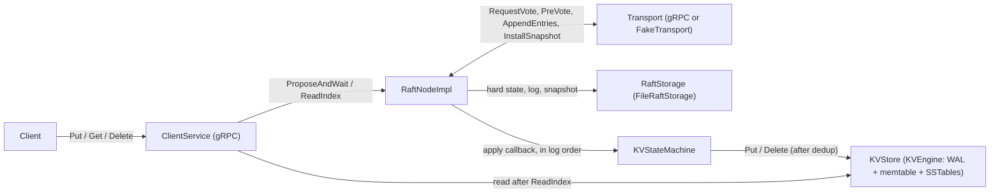
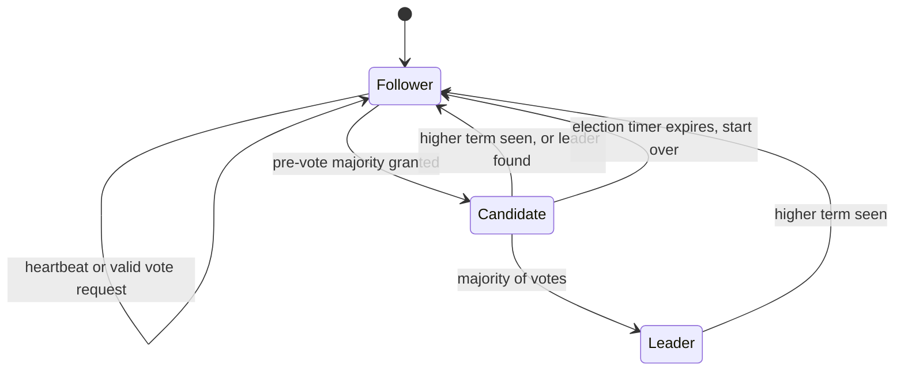
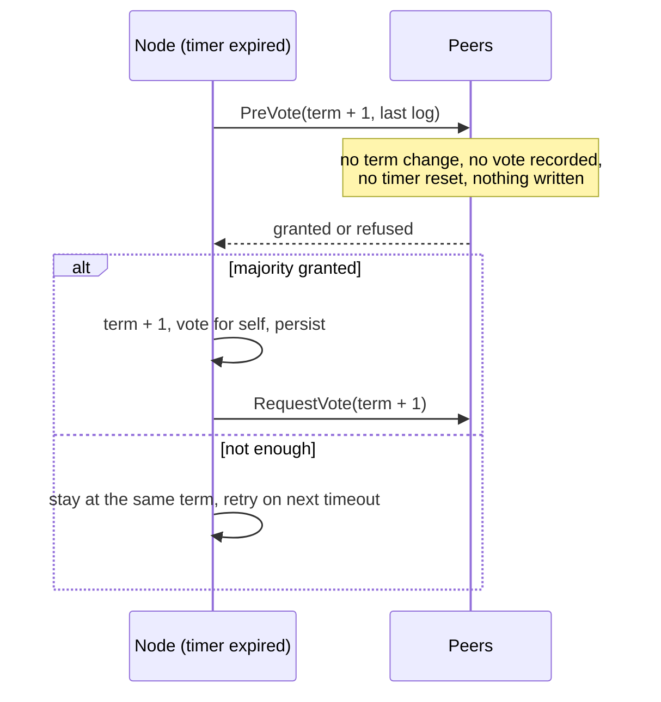
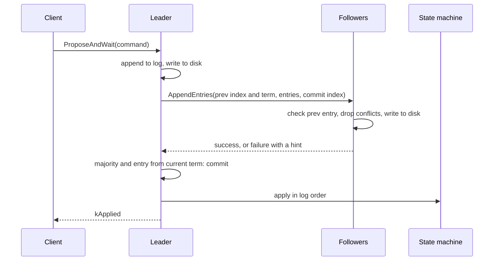
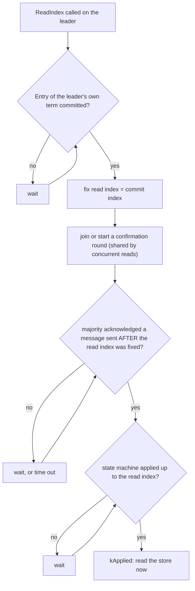
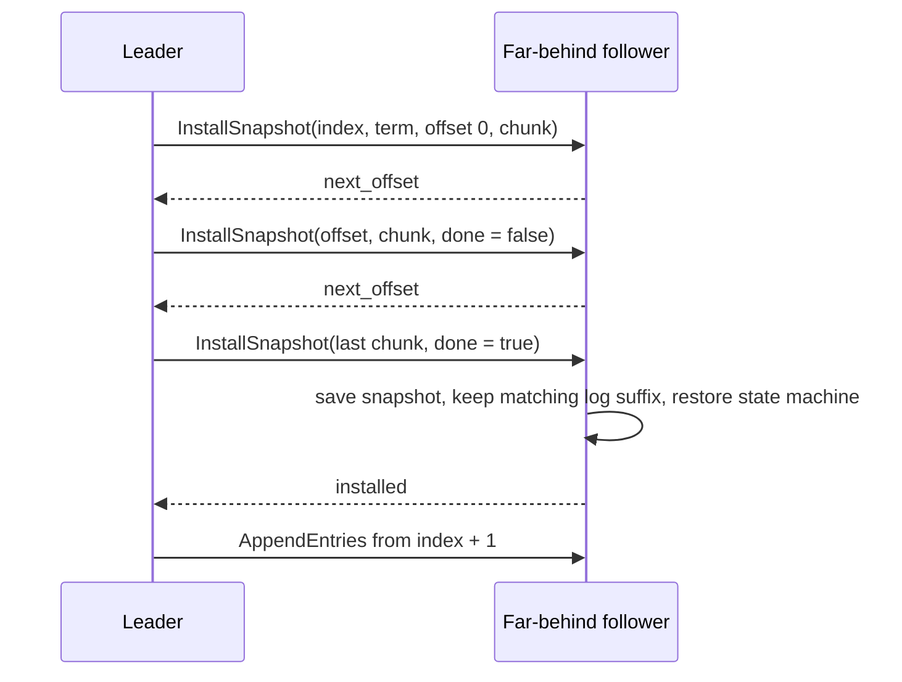

# RaftKV: Raft design

This document describes the consensus layer of RaftKV (`src/raft/`): what it guarantees, how it is
built, how it survives crashes, and how it is tested. It follows the Raft paper (Ongaro and
Ousterhout, "In Search of an Understandable Consensus Algorithm") and the extended thesis, and says
explicitly where we go beyond or differ from them. Diagrams are Mermaid and render on GitHub.

| Feature | Where | Main tests |
|---|---|---|
| Leader election, terms, votes | `raft_node.cpp` | `raft_election_test.cpp` |
| PreVote | `raft_node.cpp` | `prevote_test.cpp` |
| Log replication, commit rule, ordered apply | `raft_node.cpp` | `raft_replication_test.cpp` |
| Bounded messages (entries and bytes) | `raft_node.cpp`, `message_size.h` | `append_bytes_test.cpp` |
| Durable state, crash recovery | `file_raft_storage.cpp` | `file_raft_storage_test.cpp`, `raft_persistence_test.cpp` |
| Wait for commit (`ProposeAndWait`) | `raft_node.cpp` | `raft_commit_wait_test.cpp` |
| Exactly-once client requests | `client_sessions.h` | `exactly_once_test.cpp` |
| Linearizable reads (`ReadIndex`) | `raft_node.cpp` | `read_index_test.cpp` |
| Snapshots, log compaction, `InstallSnapshot` | `raft_node.cpp`, `file_raft_storage.cpp` | `snapshot_test.cpp` |
| End to end over the real storage engine | `tests/integration/` | `replicated_kv_test.cpp` |

## 1. Goals and failure model

RaftKV replicates a key-value state machine over `n` nodes (normally 3 or 5) so that it keeps
working while a majority is alive and connected.

**Guarantees (safety, always, regardless of timing):**

- *Election safety:* at most one leader per term.
- *Log matching:* if two logs hold an entry with the same index and term, the logs are identical up
  to it.
- *Leader completeness:* an entry committed in some term is present in the log of every later leader.
- *State machine safety:* every node applies the same commands in the same order.
- *Linearizability for clients:* writes via `ProposeAndWait`, reads via `ReadIndex`, with
  exactly-once effect for retried writes (section 7).

**Liveness** needs a majority of nodes that are up and can talk to each other, and message delays that
are eventually small compared with the election timeout.

**Failure model:** nodes crash and restart (crash-recovery) and the network drops, delays, duplicates
and reorders messages. Nodes are not malicious (no Byzantine faults). Disk writes that fail are treated
as fatal: the node aborts rather than carry on without being able to remember a vote or an entry
(section 6).

## 2. Architecture

The Raft node knows nothing about keys or values. It replicates opaque `Command` records
(`Put`, `Delete`, `Noop`, plus a client id and sequence number) and delivers committed ones to a callback.
Shared contracts live in `raft_interface.h` (`RaftNode`, `Command`, `LogEntry`, `CommitResponse`),
`transport.h`, `rpc_messages.h` and `raft_storage.h`; they change only through a PR and a team notice.

### Threads and locking

- One mutex, `mu_`, guards all Raft state. Handlers for incoming RPCs (called by the transport on its
  own threads) take it for the whole request.
- **Ticker thread** (10 ms tick): sends heartbeats if leader, starts an election round if the election
  timer expired.
- **Applier thread**: the only thread that calls the state machine. It delivers committed entries in
  order, restores the state machine from a snapshot, and takes snapshots. Doing all three on one thread
  is what makes a snapshot match exactly the entries applied so far. It never holds `mu_` while it runs
  the callback, so a callback may call back into the node.
- Transport sends must not block: they are issued with `mu_` held. Replies arrive on transport threads
  and take `mu_` again.
- Condition variables: `apply_cv_` wakes the applier; `wait_cv_` wakes callers blocked in
  `ProposeAndWait` and `ReadIndex` when entries are applied, replaced, or leadership changes.

## 3. Leader election

Every node is a follower, candidate or leader. Time is divided into terms; each term has at most one
leader.

**Timers.** Election timeout is random in 150 to 300 ms (seeded per node id, so tests are repeatable);
heartbeat interval is 50 ms. Hearing from a valid leader, or granting a vote, resets the timer.

**Voting rules.** A node grants a vote if the candidate's term is at least its own, it has not voted for
someone else in that term, and the candidate's log is at least as up to date (higher last term, or equal
last term and at least as long). The new term and the vote are written to disk **before** the reply is
sent, otherwise a restart could make the node vote twice in one term.

**No-op on election.** A new leader appends a `Noop` entry in its own term. Raft only lets a leader
commit entries of its own term by counting replicas, so this is what lets entries from earlier terms
commit right after the election instead of waiting for the next client write. The no-op is never
delivered to the apply callback.

### PreVote

Without PreVote, a node that is cut off keeps timing out and raising its term. When it returns, its high
term makes the healthy leader step down. PreVote (thesis section 9.6) avoids this:

A peer grants a pre-vote only if the proposed term is above its own, it is not the leader, it has **not
heard from a leader within the minimum election timeout**, and the candidate's log is up to date. A reply
carries the peer's current term, so a candidate that is behind adopts it. A transport that cannot carry
PreVote reports `SupportsPreVote() == false`, and the node then uses plain elections; otherwise a
transport that silently dropped pre-votes would make every election fail.

## 4. Log replication

The leader keeps, per follower, `next_index` (next entry to send) and `match_index` (highest entry known
to be replicated).

- **Consistency check.** A follower rejects an AppendEntries whose previous entry it does not have. It
  replies with its last log index, and the leader jumps `next_index` back to it instead of probing one
  entry at a time.
- **Conflicts.** If an existing entry has a different term than the new one at the same index, that entry
  and everything after it is deleted. Entries it already has are left alone, so duplicated or reordered
  messages are harmless.
- **Bounded messages.** One AppendEntries carries at most 64 entries and about 1 MiB, but always at least
  one entry, so a single large entry still gets through. This was added after a test showed that a
  follower that missed more than 4 MiB of committed data could never catch up over gRPC's 4 MiB message
  limit.
- **Commit rule.** An entry is committed once a majority stores it and it belongs to the leader's own
  term. Older entries commit indirectly.
- **Everything is written to disk before it is acknowledged or counted.**

### Group commit

Every log write is followed by an fsync, and on a laptop SSD an `F_FULLFSYNC` takes several
milliseconds, so one fsync per proposal would cap throughput at a few hundred writes per second no
matter how many clients there are. Concurrent proposals are therefore batched:

- A proposer queues its command and, if no batch is being written, becomes the **batcher**: it takes
  everything queued, appends it to the log with **one** write and **one** fsync, then wakes the others.
  While one batch is being written the next one accumulates, so batches grow with the load.
- **The leader's fsync overlaps the followers'** (Raft thesis 10.2.1). Under the node lock the batcher
  writes the batch to the log file without syncing it and sends it to the followers at once; then it
  syncs **outside** the lock, while the followers write theirs. The leader counts itself toward a commit
  majority only up to `durable_index_`, the last index known to be on its disk; followers still sync
  before acknowledging. So a commit still means a majority holds the entry on disk, and a write waits for
  about one fsync instead of two in a row.
- The sync goes through a `dup()` of the log's descriptor, so it needs no lock: if a compaction replaces
  the file meanwhile, syncing the old one is harmless (the compaction wrote and synced everything it
  kept). `log_epoch_` changes whenever entries are removed (truncation, snapshot install), so a sync
  that finishes after its entries were replaced cannot mark the replacements durable. At startup a node
  syncs its loaded log once, so entries written but not yet synced before a restart cannot count as
  durable. Every other storage write (votes, truncations, the leader's no-op and configuration
  entries, a follower's appends) is still synchronous under the lock; a storage that does not
  implement the split (`AppendEntriesNoSync`, `PrepareSync`) stays fully synchronous.
- Measured with simulated 150 ms fsyncs (`FsyncOverlap.AWriteWaitsForOneFsyncNotTwo`): a write takes about
  150 ms instead of about 300 ms.
- **Adaptive delay.** Proposers that just finished a batch are about to propose again. If the next batcher
  wrote at once it would catch only the stragglers, and the group would fall apart into tiny batches
  (it did, on a laptop: 161 writes for 320 proposals). So a batcher waits up to 2 ms for as many proposals
  as there are proposers inside `Propose`/`ProposeAndWait`. The rule corrects itself: when batches shrink,
  more proposers pile up inside and the wait grows. A lone client never waits.
- Measured: 320 concurrent proposals take about 12 log writes (`GroupCommit.*` tests, under CPU
  pressure); on the 3-node laptop benchmark 32 durable writers reach about 5x the throughput of one.

`ProposeAndWait(command, timeout)` returns one of: `kApplied` (committed **and** the apply callback has
returned for it), `kNotLeader` (with a leader hint), `kLost` (another leader overwrote the entry, so it
never committed and a retry is safe), `kTimeout` (unknown: it may still commit), or `kStopped`.

## 5. Reads: ReadIndex

Reads must not return stale data, even from a leader that has been replaced without knowing it. The
simple fix, appending a no-op through the log for every read, makes a read as expensive as a write and
fills the log. `ReadIndex` (thesis section 6.4) writes nothing:

Three details make this correct, and each has a test that fails without it:

1. **Own-term entry first.** A brand-new leader's commit index can lag behind writes its predecessor
   already acknowledged, so it must first commit an entry of its own term.
2. **Acknowledgments must be newer than the read.** Every message sent to a follower gets a sequence
   number; a read counts only acknowledgments for numbers issued after its read index was fixed. An old
   acknowledgment says nothing about whether the node is still leader now.
3. **Wait for the state machine**, not just for the commit index.

Any reply in the leader's own term counts as an acknowledgment, even a rejection: the peer accepted this
node as leader at that moment. If the node is partitioned away it cannot collect a majority and the read
times out instead of returning stale data. The default implementation of `RaftNode::ReadIndex` falls back
to a no-op through the log, so a test double that does not override it keeps working.

### Batching concurrent reads

Originally every read started its own heartbeat round, so 32 concurrent readers sent 32 rounds, doubled
the replies, and every reply woke every waiting read; on the laptop benchmark read throughput peaked at
4 clients and then fell. Rule 2 above says what a read needs: a majority acknowledging *some* message sent
after its read index was fixed. It does not need a round of its own. So:

- Every broadcast is a round: heartbeats and write batches as well as reads. At most one round is in
  flight for reads.
- A read that arrives while a round is in flight cannot use that round: its messages were sent before
  the read's index was fixed. It asks for the next round instead, and **one** new round for all such
  reads starts as soon as the in-flight round is acknowledged by a majority (or with the next heartbeat,
  if it never is, for example when messages are lost).
- The condition a read waits for is unchanged; only the number of rounds sent changes.

Measured: 640 concurrent reads send 92-208 messages instead of 1,280. The tests (`ReadBatching.*`) also
cover a read that misses the in-flight round (it must not wait for a heartbeat), a follower down, lost
messages, and a randomized run of concurrent reads and writes through message delays, losses,
duplicates and leader crashes whose whole history is checked by the linearizability checker. Breaking
the rule (letting a read use the older in-flight round) is caught by
`ReadIndex.IsolatedLeaderCannotConfirmALeaderRead`.

## 6. Persistence and crash recovery

What must survive a crash: the current term, the vote in it, the log, and the latest snapshot.
`commit_index` and `last_applied` are deliberately not stored: they are re-learned from the leader and by
replaying the log, which is safe because applying is deterministic and deduplicated (section 7).

`FileRaftStorage` is one append-only file, `raft.log`, of checksummed records
`[u32 length][u32 crc32][payload]`:

| Type | Payload | Meaning |
|---|---|---|
| 1 | term, voted_for | hard state; the last one wins |
| 4 | index, term, command, client id, seq | a log entry (type 2 is the older layout without client id) |
| 3 | from_index | truncate that entry and everything after |
| 6 | log base and snapshot index and term | the log starts after the base; the snapshot is at its own index (type 5 is the older layout where both are equal) |

- **Torn tails.** On `Load`, a record that is incomplete or fails its checksum at the end of the file is
  cut off, so a crash in the middle of a write recovers to the last complete record. Invalid data before
  the end is real corruption and makes `Load` fail.
- **Durability.** Every write is followed by an fsync; on macOS this is `F_FULLFSYNC`, because plain
  `fsync` there only reaches the drive's cache. A failed write or fsync aborts the node.
- **Snapshots are two files plus an atomic switch.** `snapshot-<index>.bin` is written first (temp file,
  fsync, rename), then `raft.log` is replaced by a new file holding the hard state, the log base and the
  entries to keep, again by rename. The rename of `raft.log` is the commit point. A crash before it leaves
  the old log, which still points at the old snapshot (kept until the switch); a crash after it leaves
  the new pair. Leftover files from a crashed attempt are deleted on `Load`.

### Replay after a restart, and the engine's applied index

A restarting node replays its log through the state machine. The storage engine records, together
with the data and in the same write, the index of the last entry it applied (a reserved key; see
`docs/storage-design.md`). On replay, entries at or below that index still update the client session
table, which has to be rebuilt, but their store writes are skipped. The index is written after the data
it covers, so after a crash it can lag the data by one operation (re-applying that one is harmless) but
never run ahead of it. The engine's own write-ahead log is **not** fsynced: the Raft log is the durable
copy, and an engine that lost its unsynced tail, its whole directory, or the middle of its WAL is rebuilt
from the Raft log or a snapshot (`ReplaySkipTest.*`, `NodeClusterTest.ANodeWhose*`,
`NodeClusterTest.ADamagedEngineWalDoesNotStopANodeFromStarting`).

## 7. Exactly-once client requests

A client that times out cannot know whether its write was applied. If it retries a non-idempotent command
blindly, it could be applied twice. Each client therefore picks a random non-zero `client_id` and numbers
its requests `1, 2, 3, ...`; a retry reuses the same number. The replicated state machine keeps, per
client, the highest sequence number applied (`ClientSessionTable`) and skips anything at or below it.

This works because the table is updated only in log order, so every replica takes the same decisions, and
because it is rebuilt by replaying the log and stored inside snapshots (otherwise a node restored from a
snapshot would re-apply a retried write). It assumes the usual one-request-in-flight client model. The
client service answers a retry of the latest applied request with success, and a stale sequence number
(older than the latest) with an explicit "stale" status rather than a false success.

## 8. Snapshots and log compaction

Without compaction the log grows forever and a new or lagging node would replay all history.

- **Taking.** When `snapshot_threshold_entries` entries have been applied since the last snapshot, the
  applier thread asks the state machine for an opaque byte string (`SnapshotTaker`) and compacts: it
  saves the snapshot and drops the log prefix. The payload must contain everything needed to continue
  from that index, **including the client session table**.
- **Trailing entries.** `snapshot_trailing_entries` keeps that many entries below the snapshot, so a
  follower that is only slightly behind is caught up with log entries instead of a whole snapshot. The
  log may therefore start before the snapshot; after a restart the state machine is restored from the
  snapshot and those covered entries are not fed to it again.
- **Catching up a far-behind follower.** When `next_index` falls into the dropped part of the log, the
  leader sends the snapshot in chunks, one at a time, each acknowledged before the next
  (`InstallSnapshot`). Chunking keeps every message under the transport limit.

The follower checks the offset of every chunk and answers with the offset it expects, so duplicated,
lost and reordered chunks are repaired by retransmission. It keeps its own log entries after the snapshot
only if it holds the snapshot's last entry with the same term.

**With the real engine.** A snapshot is the engine's checkpoint (every live key, newest version, merged
from all memtables and SSTables, plus the applied index) together with the client session table.
Installing one replaces the engine's whole dataset with a single SSTable through one manifest edit, so a
crash leaves the old dataset or the new one, never a mix, and flushes or compactions that were running
discard their results. A node restarting from its own snapshot usually already holds that state (and
more) in its engine, so the dataset is replaced only if the engine is behind the snapshot. Snapshots are
on by default in `raftkv_node` (every 10,000 applied entries), so the Raft log stays bounded.

## 9. Membership changes

Servers are added and removed one at a time, the method of the Raft thesis (chapter 4), while the
cluster keeps serving. Changing one server at a time is safe because any majority of the old
configuration and any majority of the new one share at least one server, so the two can never
elect different leaders or commit different entries; changing several at once would need joint
consensus.

- **The configuration travels through the log.** A `kConfig` entry carries the members and their
  Raft addresses. Every server uses the **latest configuration in its log, committed or not**, for
  every majority it counts: commits, elections, PreVote and ReadIndex. A follower whose log is
  truncated falls back to the previous configuration. Configuration entries are never given to the
  state machine.
- **One change at a time**, and only once the leader has committed an entry of its own term. A new
  leader may still hold an uncommitted configuration entry from an earlier term; changing again on
  top of it could break the overlap of majorities (the bug in the original single-server algorithm,
  corrected in the thesis's erratum).
- **New servers catch up first.** `AddServer` replicates the log to the new server as a non-voting
  learner, in rounds, until a round finishes within an election timeout; only then is the new
  configuration appended. Adding an empty server as a voter at once could stall commits until it
  caught up.
- **Removing.** The leader stops replicating to a removed server as soon as the new configuration is
  in its log. A leader that removes itself keeps leading until that entry commits (counted without
  itself), then steps down. A server that is not a member never starts an election, and PreVote keeps a
  removed server that never learned of its removal from disrupting the cluster: the members refuse it
  while they hear from a leader.
- **Snapshots carry the configuration.** Compaction drops the entries that carried it, so the snapshot
  bytes are wrapped in a small envelope with the configuration at the snapshot point; the state
  machine only ever sees what is inside. Snapshots written before membership changes existed have no
  envelope and mean the initial configuration.
- **Addresses.** A new member's Raft address is part of its configuration entry, and every node hands
  new addresses to the gRPC transport as configurations arrive, so no node needs restarting.

In practice: start the new node with `raftkv_node --join` (or `scripts/run_cluster.sh add ID`), then
`raftkv_cli add-node ID HOST:PORT`; `remove-node ID` removes one. Each node's `status` lists its members.

## 10. Failure scenarios and what happens

| Scenario | Behavior | Test |
|---|---|---|
| Leader crashes | A follower times out, wins an election, appends a no-op, and commits earlier entries | `CommittedEntriesSurviveLeaderFailure`, `ReplicatedKV.LeaderKilledMidWriteLosesNothingAndDoublesNothing` |
| Follower cut off for a long time | Its term does not grow (PreVote); on return it receives log entries or a snapshot | `PreVote.IsolatedFollowerDoesNotInflate...`, `LaggingFollowerCatchesUp...` |
| Leader cut off and replaced | It cannot confirm a read; the new leader serves reads and writes | `ReadIndex.NeverServesAStaleReadFromAReplacedLeader` |
| Client retries after a timeout | Applied once, answered with success | `exactly_once_test.cpp`, `ReplicatedKV.ResentRequest...` |
| Crash in the middle of a disk write | The torn record is dropped on restart | `file_raft_storage_test.cpp`, `raft_persistence_test.cpp` |
| Crash in the middle of a snapshot | Old log and snapshot stay valid, leftovers are removed | `FileRaftStorageSnapshot.LeftoversFromACrashedSnapshot...` |
| Whole cluster restarts | State comes back from log and snapshot; no write is lost or doubled | `ReplicatedKV.WholeClusterRestart...`, `RaftSnapshot.ChaosWithSnapshotsLosesNothing` |
| Large writes | Messages stay bounded; a lagging follower still catches up | `append_bytes_test.cpp` |
| Follower down while the leader compacts its log | It is sent the leader's snapshot, which replaces its engine's data | `NodeClusterTest.ALaggingFollowerCatchesUpFromASnapshotThatReplacesItsOldData` |
| A node loses its engine's WAL or whole data directory | Rebuilt from its Raft log or snapshot | `NodeClusterTest.ANodeWhoseEngineLostItsWalRebuildsFromTheRaftLog`, `...EngineDirectoryIsGone...` |
| Many concurrent clients | Writes share fsyncs, reads share confirmation rounds | `GroupCommit.*`, `ReadBatching.*` |
| The leader's disk is slow | It replicates before its own fsync finishes, but counts itself toward a commit only once its copy is on disk | `FsyncOverlap.TheLeaderDoesNotCountItselfBeforeItsOwnFsync` |
| A machine dies and is replaced | Its id is removed and a new node is added; the new node catches up first | `Membership.AFailedServerIsReplacedByANewOne`, `NodeClusterTest.ANewNodeIsAddedOverGrpcAndAnOldOneRemoved` |
| The leader removes itself | It leads until the change commits, then steps down; the others elect a leader | `Membership.TheLeaderCanRemoveItselfAndHandsOver` |

## 11. How it is tested

- **Deterministic network.** `FakeNetwork` delivers messages from one worker thread and can disconnect and
  reconnect nodes, drop messages above a size limit, and simulate crash and restart of a node, so
  failures are reproducible. A hand-driven transport lets a test answer individual messages itself, which
  is how the subtle ReadIndex and PreVote rules are pinned down.
- **Crash tests use real files.** `Cluster(n, persistent)` and the integration tests restart nodes from
  actual `FileRaftStorage` and `KVEngine` directories.
- **Randomized chaos.** Seeded runs crash and partition nodes while a client writes; every acknowledged
  write must be on every node at the end, also after a full restart.
- **Membership changes** (`membership_test.cpp`): majorities over the new configuration after an add
  and after removals, a removed server that neither counts nor disrupts, catch-up, one change at a
  time, and the configuration surviving snapshots and a full restart. One rule is not covered by a
  test: a new leader waiting for an entry of its own term before a change (it needs a leader that has
  been elected but cannot commit, which the simulated network cannot arrange deterministically).
- **Overlapped fsyncs** (`fsync_overlap_test.cpp`): with simulated slow disks, a write waits for one
  fsync, not two; the leader and one fast follower (an exact majority) do not commit before the leader's
  own fsync finishes; acknowledged writes survive a full restart; the file storage's duplicate-descriptor
  sync survives a compaction that replaces the log file. Two defensive guards are not covered by a test:
  `log_epoch_` (it needs a sync to outlast a lost leadership, a truncation and a re-election) and the
  sync of the loaded log at startup (it protects against a machine crash, which a test cannot cause).
- **Fault injection.** `FakeNetwork` can also drop, duplicate, delay and reorder messages and cut single
  links, while checkers verify election safety, log agreement and that committed entries survive
  (`docs/fault-injection.md`).
- **Linearizability checking.** `src/checker/linearizability.h` decides whether a recorded history of
  concurrent operations could have come from a single copy of the store; writes whose outcome is unknown
  may or may not have happened. It checks the randomized read/write runs above.
- **Sanitizers.** Raft and storage changes run under AddressSanitizer plus UndefinedBehaviorSanitizer
  and ThreadSanitizer, and CI runs both on every pull request (with macOS and Linux builds);
  timing-sensitive tests are repeated.
- **Mutation checks.** For each safety rule we deliberately break the code and confirm a test fails
  (for example: skip the majority check in `ReadIndex`, count old acknowledgments, drop the session table
  from snapshots, drop the kept log suffix). A rule that no test can fail on is not tested.
- Raft tests must run serially: they are timer-based and fail spuriously under heavy parallel load.

## 12. Limitations and future work

- **Membership changes are one server at a time** (no joint consensus), so replacing a machine is two
  changes: remove its id, then add the new node. A member must keep its disk: a member that is wiped
  and returns under the same id breaks Raft's assumption that persisted state survives. Remove it
  first; the same id may then be added again with an empty data directory.
- **A removed server is not told.** It stops receiving messages and stays idle (PreVote keeps it from
  disrupting the others); stop it once its removal has committed.
- **No leader leases.** Reads still need a confirmation round (now shared by concurrent reads). Leases
  would remove it at the cost of depending on bounded clock drift.
- **Snapshots are built in memory**, so a snapshot must fit in RAM; streaming them would remove that.
- **Client sessions** are forgotten deterministically (idle for 1,000,000 log entries, or the least
  recently active beyond 100,000 sessions); a request that might be a retry of a forgotten one is refused
  with `SESSION_EXPIRED`, never applied twice. One narrow case remains: a client's *first* request,
  retried after its session was already forgotten, can apply twice. Closing it needs server-assigned
  client ids (registration through the log). All nodes must run the same version, or their expiry
  decisions differ.
- A storage failure aborts the node by design.

Done since the first version of this document: snapshots of the engine's data, the persisted applied
index, `InstallSnapshot` and PreVote over gRPC, group commit for writes, batching for reads, client
session expiry, membership changes, and the leader's fsync overlapping the followers'.

## 13. Where the paper's rules live

| Raft paper (Figure 2) | Code |
|---|---|
| Persistent state: current term, voted for, log | `PersistentState`, `PersistHardStateLocked`, `PersistAppendLocked` |
| RequestVote receiver | `HandleRequestVote` |
| AppendEntries receiver | `HandleAppendEntries` |
| Followers, candidates: timeouts and elections | `TickerLoop`, `StartPreVoteLocked`, `StartElectionLocked` |
| Leaders: heartbeats, replication, backing up | `BroadcastAppendEntriesLocked`, `SendAppendEntriesToLocked`, `OnAppendEntriesReply` |
| Leaders: commit rule | `AdvanceCommitIndexLocked` |
| Apply to the state machine | `ApplierLoop` |
| InstallSnapshot RPC | `SendSnapshotChunkLocked`, `HandleInstallSnapshot`, `InstallSnapshotLocked` |
| Log compaction | `CompactLocked` |
| Read-only operations | `ReadIndex` |
| The leader writes its disk in parallel with replication (thesis 10.2.1) | `SubmitProposal`, `durable_index_`, `AdvanceCommitIndexLocked` |
| Membership changes (thesis chapter 4) | `AddServer`, `RemoveServer`, `RecomputeConfigLocked`, `MajorityLocked` |
