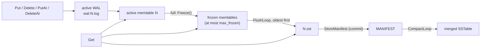

# RaftKV Storage Engine Design

| | |
|---|---|
| Scope | The per-node storage engine: WAL, memtables, flush, SSTables, manifest, compaction, recovery, checkpoints |
| Code | `src/storage/` (`kv_engine.{h,cpp}`, `wal.*`, `memtable.*`, `skiplist.h`, `sstable.*`, `bloom_filter.*`, `compaction.*`, `manifest.*`, `checkpoint.h`) |
| Tests | `tests/storage/` (engine: `kv_engine_lsm_test.cpp`, `kv_engine_flush_test.cpp`, `kv_engine_checkpoint_test.cpp`, `kv_engine_async_wal_test.cpp`, `kv_engine_applied_index_test.cpp`, `kv_engine_test.cpp`) |
| Related | `docs/sstable-format.md` (normative SSTable file format and compaction rules), `docs/raft-design.md` (how Raft drives the engine) |

This document describes what the code does today. Where a behaviour is a limitation rather than a
guarantee, it is listed in section 12. Section 13 lists statements in older documents that the
implementation has since superseded.

## 1. Overview and modes

`KVEngine` (`kv_engine.h`) implements `CheckpointableStore` (`checkpoint.h`), which extends
`IndexedKVStore` (`kv_store.h`): `Put`, `Get`, `Delete`, `PutAt` / `DeleteAt` (write plus the Raft
applied index), `AppliedIndex`, `Checkpoint` and `InstallCheckpoint`.

The engine has two modes, chosen by `Options::use_sstables`:

| Mode | Flush target | Manifest | Compaction | Used by |
|---|---|---|---|---|
| SSTable mode (`use_sstables = true`) | `NNNNNN.sst` written by the engine | `MANIFEST` | background thread | the node (`node_runtime.h`: `use_sstables = true` by default) |
| Legacy mode (`use_sstables = false`, the `Options` default) | `Options::flush_writer`, if set; otherwise nothing is ever frozen or flushed | none | none | older tests, the flush test seam, and the node with `--no-sstables` |

The two flush paths are mutually exclusive: `Open` returns `kInvalidArgument` if `use_sstables` and
`flush_writer` are both set. Everything below describes SSTable mode unless it says otherwise.



## 2. Files in the data directory

| Name | Written by | Meaning |
|---|---|---|
| `wal-NNNNNN.log` | `WAL` | one log per memtable; `N` is that memtable's sequence number |
| `NNNNNN.sst` | `SSTableBuilder` | an SSTable; live only if the manifest lists it |
| `NNNNNN.sst.tmp.XXXXXX` | `SSTableBuilder` | a table being written (published by `link`, never by overwrite; `sstable-format.md` §12.2) |
| `MANIFEST` | `StoreManifest` | the complete live state (section 5) |
| `MANIFEST.tmp` | `StoreManifest` | a manifest being written; renamed over `MANIFEST` |
| `LOCK` | `DirLock` | empty; held with `flock` for the engine's whole life (section 2.1). Never deleted |

WAL sequence numbers and SSTable file numbers come from **one counter** (`next_seq_`, persisted as
the manifest's `next_file_number`), so a number is never handed out twice (section 7, step 2). File names
are parsed by `ParseName` in `kv_engine.cpp` (at most 18 digits).

### 2.1 The directory lock (`DirLock`, `dir_lock.h`)

`KVEngine::Open` takes an exclusive, non-blocking `flock` on `<dir>/LOCK` **before** it constructs the
engine or reads, recovers or changes anything in the directory (recovery deletes orphan files and
truncates WALs, which would damage a running engine). The lock is held by a `DirLock` member that is
declared first and so destroyed last: after the flusher and compactor have been joined and the WALs and
SSTables closed, another engine can take the directory. A failed `Open` releases it as its local
objects unwind.

- **Contention.** If another engine, in this process or another, holds the lock, `Open` returns
  `kIOError` and `*out` is untouched; nothing in the directory has been created, deleted or modified
  (apart from creating the empty `LOCK` file if it did not exist). `raftkv_node` reports this as
  "cannot open the storage engine … if another raftkv_node is running on this data directory, stop it
  first" and exits with status 1.
- **Release.** Closing the descriptor releases the lock: at engine destruction, and also when the
  process dies for any reason, `kill -9` included, so a crash never leaves a stale lock. (`flock` locks
  belong to the open file description; the descriptor is `O_CLOEXEC`, so a child that `exec`s does not
  inherit it. A child that only `fork`s shares the description and with it the lock until it exits.)
- **The file.** `LOCK` is created on first use and never removed or replaced: deleting a lock file that
  others may be opening lets one process lock the old inode and another the new one. It holds no data,
  and recovery ignores it (it matches none of the name patterns above).
- **Platforms.** `flock` is available on Linux and macOS, the supported platforms, and the lock tests are
  part of the suites that CI runs on both. It is an advisory lock: it stops cooperating `KVEngine` instances, not a process that opens the
  files by hand. On a network file system `flock` may be emulated or unsupported, so keep the data
  directory on a local file system.
- **Scope.** The lock protects the engine's directory (`<data-dir>/kv/` for a node). A second node
  started on the same `--data-dir` fails when it opens the engine, which happens before the node
  reads or writes the Raft log, so it cannot disturb the first one's state.
- Tested by `DirLockTest.*` (`tests/storage/dir_lock_test.cpp`), including a child process that holds the
  directory, is refused, and is killed with SIGKILL.

## 3. Write path

`KVEngine::Write` (shared by all four write calls) runs under `write_mu_`, which serialises writers so
that WAL order equals memtable order:

1. **Reserved keys.** `Put` / `Delete` / `PutAt` / `DeleteAt` reject keys with `kReservedKeyPrefix`
   (`kInvalidArgument`); the engine uses that prefix for its own `applied_index` key.
2. **Applied-index order.** `PutAt` / `DeleteAt` require `raft_index > AppliedIndex()` and
   `raft_index != 0`, else `kInvalidArgument` and nothing is written.
3. **Room.** `EnsureRoom` (section 4.1) may freeze the active memtable first, so the data record and
   its applied-index record always land in the **same** WAL and memtable.
4. **WAL first.** The record is appended to the active WAL (`WAL::AppendPut` / `AppendDelete`). With
   an index, the data record is appended without a sync, then the index record
   (`applied_index` = 8-byte little-endian `raft_index`) with one sync (if `sync_wal`). A crash can
   therefore lose the index record but never leave the index ahead of its data.
5. **Memtable second.** Only after the WAL append succeeded is the memtable updated (and
   `applied_index_` advanced). A write whose WAL append failed is not applied and returns
   `kIOError`.

**Durability.** With `sync_wal = true` (the `Options` default) every acknowledged write is fsynced
(`FullSync`: `fsync`, or `F_FULLFSYNC` on macOS). With `sync_wal = false` the record is written with
one `write()` but not fsynced; see section 10 for what recovery then guarantees.

**WAL record format** (`wal.h`): `[crc32:4][payload_len:4][payload]`, payload =
`[type:1][key_len:4][key][value]`, type 1 = put, 2 = delete; little endian; the CRC covers the
payload. After any failed write or fsync the `WAL` object refuses further appends (`failed_`), because
the file may end in a partial record that would hide later records.

**Memtable** (`memtable.h`, `skiplist.h`): a concurrent insert-only skip list. Readers take no lock;
an overwrite pushes a new version; a delete is a tombstone version. Nothing is freed until the
memtable is destroyed, so `ApproximateBytes()` only grows; `ShouldFlush()` is
`ApproximateBytes() >= memtable_bytes` (default 4 MiB).

## 4. Memtable freezing and flush

### 4.1 Freezing and back-pressure

`EnsureRoom` runs before every write:

- if the engine has stopped (`dead_`), the write fails with `kIOError`;
- if the active memtable is not full (or neither flush path is enabled), the write proceeds;
- if fewer than `max_frozen` (default 2) memtables are frozen, `Freeze()` runs;
- otherwise the writer waits on `cv_` for a flush to finish, **unless** the last flush attempt failed
  (`flush_failing_`) or the engine is stopping, in which case it fails fast with `kIOError`.

`Freeze()` first syncs the old WAL (so a frozen WAL is complete on disk even with `sync_wal = false`),
creates the next WAL `wal-(N+1).log` and syncs the directory, then moves the active memtable to the
front of `frozen_` and publishes a new read view. If creating the new WAL fails, nothing changes and
the write fails. If syncing the old WAL fails, that `WAL` refuses every later append (`failed_`), so
every later write fails until the engine is reopened.

### 4.2 Flush (`FlushLoop`, one background thread)

The flusher always takes the **oldest** frozen memtable, so SSTables appear in sequence order and
`flushed_through` only grows. For memtable `N`:

1. Outside the lock: write `N.sst` with all entries **including tombstones**
   (`WriteSSTable`, meta `{N, N, N}`), then open and validate it (`SSTable::Open`).
   Crash point `flush:after_sst`.
2. Under the lock, **commit**: `StoreManifest` with `N.sst` appended to the live list and
   `flushed_through = N`. Crash point `flush:after_manifest`.
3. Delete `wal-N.log` (failure is harmless: startup retires it, section 7).
4. Remove the memtable from `frozen_` and publish a view in which `N.sst` replaces it, in one step.

A memtable and its applied-index record therefore always go into the same SSTable. On failure the
memtable and its WAL are kept, `flush_failures` and `flush_failing` are set, and the flush is retried
after `flush_retry_ms` (default 200 ms). Failure of the manifest store is handled in section 8.3.

Before writing, a retry deletes a leftover `N.sst` from an earlier failed attempt, except when that
file was kept because a manifest may name it (section 8.3).

## 5. Manifest

`manifest.h` / `manifest.cpp`. The file `MANIFEST` always holds the **complete** state:

```
header   u64 magic "RKVMANI1" | u32 format_version (1) | u32 reserved (0)
records  repeated: u16 type | u16 flags | u32 payload_length | payload
trailer  u32 CRC-32 of every byte before it
```

| Type | Record | Payload |
|---|---|---|
| 1 | `next_file_number` | u64: highest file/WAL number ever handed out, plus one |
| 2 | `flushed_through` | u64: every WAL with sequence <= this is in a live or merged SSTable |
| 3 | `sstable` | u64 file_number, u64 min_seq, u64 max_seq (one per live file, oldest first) |

**Validation** (`DecodeManifest`): bad magic, bad checksum, truncation, a newer `format_version`, an
unknown record with flag bit 0 (`kManifestRequired`) set, a missing required record, duplicate file
numbers, overlapping or unordered ranges, `min_seq > max_seq`, or a file number
`>= next_file_number` are all `kCorruption`. An unknown record *without* the required flag is
skipped (forward compatibility).

**Storing** (`StoreManifest`): write `MANIFEST.tmp`, fsync it, `rename` it over `MANIFEST`, fsync the
directory. Because the whole state is replaced at once, any edit (a flush, a compaction replacing
several tables, a checkpoint replacing everything) is all-or-nothing.

`StoreManifest` returns `kIOError` both when it fails **before** the rename (the old manifest is
untouched) and when the **directory fsync after the rename** fails (the new manifest is already in
place but not known to be durable, so after a crash either may be found). Callers must not assume
which; section 8 describes how each caller handles it.

`LoadManifest` reports a missing manifest as `found = false` with `kOk` (a fresh directory). A
manifest that exists but cannot be opened is `kIOError`; one that fails to decode returns the
`DecodeManifest` status, `kCorruption` for a damaged manifest, never "empty". The existence check
(`std::filesystem::exists(path, ec)`) does inspect `ec`: a filesystem error during that check (for
example a symlink loop) is `kIOError`, never a missing manifest.

Every manifest store happens while holding `write_mu_` (the flush and compaction commits, and
`InstallCheckpoint`), so there is never more than one store in progress. This is what
`ManifestMayName` (section 8) relies on.

## 6. Read path

`KVEngine::Get` takes no engine lock. It copies a `shared_ptr` to an immutable `View` under the tiny
`view_mu_` and searches, newest data first:

1. the active memtable;
2. the frozen memtables, newest first;
3. the live SSTables, newest first (by `max_seq`).

The first layer that knows the key decides: a value is returned; a **tombstone stops the search** and
returns `kNotFound`. In an SSTable, the Bloom filter can only answer "absent"; otherwise the index
locates the one candidate block (`sstable-format.md` §11.2). A damaged block is reported as
`kCorruption` (or `kIOError`), **never** as "not found".

Without a block cache, `SSTable::Get` searches the candidate block **in its encoded form**
(`ParseBlock` in `sstable.cpp`): it validates every record of the block exactly as a full decode
would (§10.2 of `sstable-format.md`, including the records after the key), but builds no `Entry`
objects and copies only the matching value, after the whole block has passed. Damage anywhere in the
block is therefore still reported (`SSTableTest.GetValidatesTheWholeBlockEvenAfterFindingTheKey`).
The `pread` and the CRC check remain on every read.

A reader keeps every `SSTable` in its view open (`shared_ptr`), so compaction can delete input files
while a reader still uses them. A `View` is replaced, never modified, so a reader never sees a
half-applied flush or compaction (tested by `LsmTest.ReadersNeverSeeTheStateGoBackwardsWhileFlushingAndCompacting`).

After the checkpoint fail-stop (section 11) every `Get` and `Scan` started afterwards returns
`kIOError`.

### 6.1 Block cache (`Options::block_cache_bytes`, default 0 = off)

With a non-zero capacity the engine creates one `BlockCache` (`block_cache.h`), an LRU of **decoded,
validated** data blocks shared by all its SSTables. `Get` and the iterators `Scan` uses read through
it; the full-table scans of compaction and `Checkpoint` (`SSTable::NewIterator()`) never do, so they
always re-validate from disk and cannot evict the blocks that reads use.

- **Identity.** A block is cached under (table id, block index). The id is taken from a process-wide
  counter when an `SSTable` object is opened, not from the file number, so tables of other
  directories, a reopened table and a table installed by a checkpoint never share entries. An SSTable
  file never changes after it is published, and one `SSTable` object reads one file, so a cached
  block can never go stale. `~SSTable` erases its blocks.
- **Validation.** Only a block that passed the full §10.2 validation is inserted; a failed read is
  never cached and fails again on the next read. A hit serves that validated copy without touching the
  disk, so damage that appears on disk after a block was cached is found when the block is next read
  from disk (after eviction, by a reopened engine, by compaction or by a checkpoint).
- **Memory.** Each block is charged its key and value bytes plus a fixed overhead per entry and per
  block; least recently used blocks are evicted until the total is within the capacity. Blocks are
  handed out as `shared_ptr`, so an evicted block stays valid for a reader or iterator still holding
  it; memory in use can exceed the capacity by those blocks.
- **Concurrency.** One mutex guards the LRU list and map; no I/O happens under it. Two readers that
  miss the same block both read it; the second insert is dropped (the contents are identical).

`raftkv_node --block-cache-bytes N` sets it for a cluster node (default 0 = no cache; plain decimal
digits only; it applies to the LSM engine, and `--no-sstables` ignores it with a warning). The size
reaches the engine unchanged, and `GetStats().block_cache_capacity` / `block_cache_usage` report it.

### 6.2 Range scans (`KVEngine::Scan`)

`Scan(start, end, limit, &out)` returns the live keys in `[start, end)` in key order with their newest
values: an empty `end` means no upper bound, `limit == 0` means no limit, `start >= end` (with a
non-empty `end`) gives an empty result. Deleted keys and the engine's reserved keys are never returned
and do not count against `limit`. On an error `out` is empty and the status is returned. It works in
both modes and is not part of `KVStore` or of the client/gRPC API.

It takes the view as `Get` does and builds one source per layer, newest first, each positioned at
`start`: the active memtable and every frozen memtable (`MemTable::NewIterator(start)`) and every SSTable
(`SSTable::NewIterator(start)`, i.e. `Iterator::Seek`). A `MergingIterator` (`merging_iterator.h`)
merges them by key; for equal keys the newest source wins and older versions are skipped, so a
tombstone hides older values and a newer value hides an older tombstone. `Checkpoint` uses the same
merge over every layer.

**Consistency: per key, not a snapshot.** No engine lock is held. The view holds every memtable and
SSTable that existed when the scan began, so every write that completed before `Scan` was called is
reflected (unless it was overwritten since). Frozen memtables and SSTables never change; a flush
swaps a frozen memtable for its SSTable in one new view, and files that a compaction or a checkpoint
install deletes stay readable through the open `SSTable`s that the old view holds (the disk space is
freed when the scan ends). Only the active memtable can change while the scan runs: a concurrent write
may or may not be seen, and different keys may reflect different moments. A value is never torn
(memtable versions are immutable). Tested by `ScanTest.ConcurrentWritesFlushesAndCompactionsNeverHideCompletedWrites`
and, against a `std::map`, by `EngineModelTest.GetAndScanAgreeWithAStdMap`.

**Errors.** A damaged block that the scan reads fails the whole scan, even when it is the block just
past `end` (the merge reads one entry ahead in every source).

### 6.3 Measured read performance

`benchmarks/storage_read_bench.cpp` (built only with `-DRAFTKV_BUILD_BENCHMARKS=ON`; usage in the
file; the benchmarks and their shared methodology are described in [`storage-benchmarks.md`](storage-benchmarks.md)). Workload: 200,000 keys of 16 bytes with 100-byte values inserted in shuffled order into an
SSTable-mode engine (1 MiB memtables, unsynced WAL), fixed seed; then 200,000 `Get`s per run of present
keys (uniform), absent keys inside the key range (uniform), and present keys from a hot 1%; 2,000
`Scan`s of 100 keys from random starts; one full `Scan`. One warm-up run, then 5 runs; median and
range in nanoseconds per operation. `--trigger 0` (no compaction) leaves 45 SSTables; `--trigger 4`
leaves 2 or 3 depending on compaction timing.

Measured 2026-10-30 on an Intel Core i5-13450HX (16 threads), 7.6 GiB visible to WSL2, Ubuntu 26.04.1
under WSL2 (kernel 6.18.54.1), g++ 15.2.0, CMake `Release` (`-O3 -DNDEBUG`), data in the page cache.
"Before" is the same benchmark built against `b9a40fa` (the scans did not exist yet). Single machine,
so treat small differences with care.

| SSTables | Workload | Before | Encoded-block search | + cache 8 MiB | + cache 64 MiB |
|---|---|---|---|---|---|
| 45 | `Get` hit, uniform | 14,273 | 11,859 | 13,024 | 2,122 |
| 45 | `Get` miss | 6,005 | 5,196 | 5,625 | 2,064 |
| 45 | `Get` hit, hot 1% | 16,635 | 13,730 | 2,395 | 2,292 |
| 45 | `Scan` 100 keys | — | 600,829 | 489,133 | 58,481 |
| 2 | `Get` hit, uniform | 11,714 | 9,492 | 10,341 (3 tables) | 1,224 |
| 2 | `Get` miss | 510 | 465 | 545 (3 tables) | 316 |
| 2 | `Get` hit, hot 1% | 11,576 | 9,393 | 2,379 (3 tables) | 852 |
| 2 | `Scan` 100 keys | — | 69,099 | 73,006 (3 tables) | 15,371 |

What the numbers show (on this machine): searching the encoded block makes reads that reach a data
block (hits) about 17–19% faster; misses, which the Bloom filter mostly answers without reading a
block, gain less (13% with 45 tables, 9% with 2). The cache removes the `pread`, CRC and decode for
blocks it holds: with 8 MiB, hot reads become about 5.7× faster with 45 tables and about 3.9× with 2–3,
and with a cache that holds the whole data set (64 MiB) uniform reads are 5.6× (45 tables) to 7.8×
(2 tables) faster. A cache smaller than the working set makes uniform reads about 9–10% slower than no
cache (each miss now decodes the block and inserts it), and a full scan through a small cache churns
it (full `Scan` of 200,000 keys: 116 ms without a cache, 136 ms with 8 MiB, 59 ms with 64 MiB, all
with 45 tables). Hence the default of 0: size the cache for the hot set.

### 6.4 Write amplification: what is counted

`KVEngine::GetStats()` carries cumulative byte counters since the engine was opened. They are measured
where the engine hands data to the file system: a counter is increased when the write succeeded, with
the real size of what was written, not an estimate. A write that failed part-way is not counted.

| Counter | Counts |
|---|---|
| `user_bytes_written` | **logical** bytes: key + value of every acknowledged `Put`/`PutAt`, key only for `Delete`. The applied-index record of `PutAt`, rejected writes and installed checkpoint data are not user bytes |
| `wal_bytes_written` | every WAL record handed to `write()` successfully: 8-byte header, type, key length, key, value. Includes the applied-index records of `PutAt` |
| `flush_bytes_written` | whole SSTable files written by memtable flushes (data blocks, Bloom filter, index, footer) |
| `compaction_bytes_written` | whole SSTable files written by compactions, including outputs later discarded as stale or because their manifest store failed |
| `checkpoint_bytes_written` | the SSTable written by `InstallCheckpoint` |
| `manifest_bytes_written` | the `MANIFEST` file after every successful store (the whole file is rewritten each time) |

`storage_write_bench` reports ratios of these over the user bytes of a workload: **WAL** =
wal/user, **flush** = flush/user, **compaction** = compaction/user, **LSM** = (flush + compaction)/user
(the usual "write amplification" of an LSM tree: how many times the data is written to tables), and
**total** = (WAL + flush + compaction + manifest + checkpoint)/user.

What it excludes: data that is still in the active memtable when the workload ends (at most
`memtable_bytes` of it has not been written to a table yet, so flush and LSM amplification are slightly
understated for small data sets); file system metadata and journal writes; directory fsyncs; and
device-level amplification (the flash translation layer). Overwrites and deletes inside one memtable
collapse before the flush, which is why amplification is a property of a workload, not of the engine
alone. The tiered compaction policy (section 8.1) is what produces the compaction share; the
benchmarks measure it and do not change it. Tested exactly (WAL bytes to the byte, flush and
checkpoint bytes against the files on disk) by `EngineStats.*` in `tests/storage/kv_engine_stats_test.cpp`.

### 6.5 Measured write performance and write amplification

`benchmarks/storage_write_bench.cpp`; how to build and run it, the workloads and the limitations are in
[`storage-benchmarks.md`](storage-benchmarks.md), which also holds the results table (200,000 keys of
16 + 100 bytes, 1 MiB memtables, unsynced WAL, 5 runs). In short, on that machine and with compaction
trigger 4, the median LSM write amplification was 3.02 (fill, ascending keys), 3.72 (fill, random keys)
and 3.02 (overwrites), against 1.09 with compaction off, and it varied between runs by up to about 1
because it depends on when compactions happen to run.

## 7. Recovery (`Open` → `Recover`)

0. **Lock** (`DirLock::Acquire`, section 2.1): before anything below. If the directory is locked,
   `Open` fails with `kIOError` and none of the following happens.
1. **Manifest and cleanup** (`LoadLsmState`):
   - load the manifest;
   - delete every directory entry whose name contains `.tmp` (unfinished writes, including
     `MANIFEST.tmp`), and every `NNNNNN.sst` the manifest does not list (an orphan of an uncommitted
     flush or compaction, or an input a committed compaction had not yet deleted);
   - if there is **no** manifest but there are SSTables, every such SSTable's WAL must still exist
     (the first flush's manifest store comes before its WAL is deleted, so this is the only crash
     that can leave it). If one is missing, open fails with `kCorruption` rather than guessing;
   - open every listed SSTable and check its footer range against the manifest. A missing,
     unreadable or mismatched table is `kCorruption`; **nothing is skipped**.
2. **Counter.** `next_seq_ = max(highest WAL or SSTable number on disk, orphans included,
   next_file_number - 1) + 1`.
3. **WALs**, oldest first:
   - a WAL with sequence `<= flushed_through` is already in an SSTable: it is deleted, never
     replayed;
   - every other WAL is replayed into its own memtable (`WAL::Replay`, which truncates a torn tail);
     a WAL damaged in the middle fails open with `kCorruption` unless `wal_truncate_on_corruption`
     is set (section 10).
4. The newest replayed WAL becomes the active memtable and keeps receiving writes; older ones are
   frozen and flushed again; empty older ones are deleted. If no WAL needs replay, a fresh active WAL
   is created.
5. `PublishView`, then the applied index is read through `Get` (the reserved key), so it is found in
   whichever layer holds it, including an SSTable after its WAL was retired. A missing key means no
   index has been persisted and leaves the applied index at 0. A malformed value returns
   `kCorruption`; any other read error is propagated and opening fails.

The crash walkthroughs are tested by the `LsmTest.ACrash*` tests (flush: before and after the
manifest store; compaction: after the output and after the manifest store; ambiguous manifest stores),
`LsmTest.LeftoverOrphansAndTempFilesAreCleanedAtStartup`,
`LsmTest.DamagedOrMissingStateIsReportedNeverTreatedAsEmpty` and
`LsmTest.SstablesWithoutAManifestAreRefusedRatherThanGuessedAbout`.

## 8. Compaction

### 8.1 Trigger and policy

`CompactLoop` (one background thread, started only if `compaction_trigger > 0`) waits until at least
`max(2, compaction_trigger)` SSTables are live (default 4; `0` = never). It then merges the **smallest
run of the newest tables** whose combined size is no larger than the table just older than the run,
or all tables if no such run exists (`NewestRunToCompact`). Table "size" is currently the SSTable's
**entry count** (`entry_count()`, at least 1), not its byte size (section 12).

The run is always contiguous, as `ValidateCompaction` requires (rule C5; it checks all of C1–C7,
`sstable-format.md` §13.2), and by this policy it always ends at the newest table. Each compaction
removes at least one table, so the loop cannot spin; it stops when fewer tables than the trigger
remain.

### 8.2 Installation and safe deletion

1. Under the lock: pick the run, snapshot the live list, take an output number from the shared
   counter and remember the engine epoch (section 9).
2. Outside the lock: `Compact` merges the inputs (k-way merge; the newest version of each key wins;
   §13.4) and publishes the output; open it. Crash point `compact:after_output`.
3. Under the lock: after a checkpoint fail-stop, stop without changing anything; if the epoch
   changed, delete the output and go back to waiting (it belongs to a replaced dataset). Check that
   the run is still at the same position (flushes only append, but this is checked, not assumed).
4. **Commit**: `StoreManifest` with the run replaced by the output in the same position. Then update
   the in-memory live list and publish a view. Crash point `compact:after_manifest`.
5. Outside the lock: delete the input files (readers holding them keep reading).

**Tombstones** are written to the output unless the run starts at the **oldest** live table
(`drop_tombstones = first == 0`, rule C7). Only then can nothing older exist for a tombstone to hide,
so the tombstone and every older version of its key are dropped. A run that does not include the
oldest table always keeps its tombstones. This is also why flush keeps tombstones in `N.sst`.

**Failures** leave the in-memory live set and the read view unchanged, never delete an input, and
count `compaction_failures`; the compaction is retried after `flush_retry_ms`.

- Merge, publication or open failed: the output is deleted (no manifest refers to it).
- **Manifest store failed**: the output is deleted only if `ManifestMayName` shows that the
  `MANIFEST` now in the directory does not list it (then the rename never happened). If it lists the
  output, or cannot be read, the output is **kept** in a list of unsettled outputs. Either manifest
  may survive a crash: with the new one the output is live and the inputs are orphans; with the old
  one the inputs are live and the output is an orphan. Startup deletes the orphans. Kept outputs are
  deleted after the next successful compaction store, whose manifest (built from the in-memory state)
  names none of them.

### 8.3 Flush and checkpoint manifest failures

The same rule protects the other two manifest stores:

- **Flush.** If the flush's store fails and `ManifestMayName` says the directory manifest lists
  `N.sst`, the table is kept (with the memtable and WAL) and the **retry reuses that file** instead
  of deleting and rewriting it. With the new manifest, recovery retires the WAL and uses the table;
  with the old one, the table is an orphan and the WAL is replayed.
- **Checkpoint install.** See section 9.2.

The failure after the rename is injected in tests through the test-only `fail_after_rename` argument
of `StoreManifest` (hook points `compact:`, `flush:` and `install:fail_after_manifest_rename` of
`Options::test_crash_hook`); see the `LsmTest.*Ambiguous*` and `ManifestTest.AFailureAfterTheRename*`
tests.

## 9. Checkpoints (Raft snapshots)

`KVStateMachine` (`src/server/kv_state_machine.h`) uses these for Raft snapshots; a failure there is
fatal to the node (`MustSucceed` aborts).

### 9.1 `Checkpoint`

Works in both modes. Under `write_mu_` it copies the active memtable and the current view and reads
the applied index, so the copy and the index describe the same instant. It then merges every layer
(newest version wins) **outside** the lock and emits only live keys: tombstones and the reserved keys
are left out (`checkpoint.h` format: `u64 count`, then `u32 klen | key | u32 vlen | value`). A damaged
SSTable block fails the checkpoint.

### 9.2 `InstallCheckpoint`

SSTable mode only (`kInvalidArgument` otherwise). Parsing happens before the lock is taken; the rest
runs under `write_mu_`:

1. parse the data (`kCorruption` if malformed);
2. write one new SSTable holding every key plus the applied index (crash point `install:after_sst`);
3. create a new empty WAL;
4. **commit**: `StoreManifest` with **only** the new table, `flushed_through` above every old WAL;
   crash point `install:after_manifest`;
5. switch the in-memory state, bump the **epoch**, publish a view, delete the old WALs and SSTables.

A flush or compaction that was running notices the epoch change when it takes the lock again and
discards its result (tested by `InstallCheckpoint.WinsOverFlushesAndCompactionsThatAreRunning` and
`LsmTest.ACompactionOverlappingACheckpointInstallIsDiscarded`).

**If the manifest store fails** the new WAL is deleted, and:

- if `ManifestMayName` shows that no manifest names the new table, it is deleted;
- otherwise the engine **stores the current (old) state again**, so the old dataset is durable before
  returning. Without this, the install's manifest could survive a crash and its `flushed_through`
  would retire WALs holding writes accepted after the failed install. If that restore succeeds, the
  new table is deleted;
- if the restore **also** fails, the new table is kept (either dataset can be recovered) and the
  engine **fail-stops** (section 11).

In every failure case `InstallCheckpoint` returns an error and the in-memory dataset is unchanged.

## 10. Asynchronous WAL (`sync_wal = false`)

The node runs the engine with `sync_wal = false` by default (`node_runtime.cpp`: `sync_wal = sync &&
sync_engine_wal`, `sync_engine_wal = false`): the Raft log is durable, and the engine can be rebuilt
from it. A power loss can then leave a **hole in the middle** of an unsynced WAL.

`Options::wal_truncate_on_corruption` (the node sets it unless `--sync-engine-wal` is given:
`wal_truncate_on_corruption = !sync_engine_wal`) makes recovery cut such a WAL at the first damaged
record, like a torn tail (`WAL::Replay(..., truncate_mid_log_corruption)`). If a WAL that lost data
is **not** the newest one, **every newer WAL is deleted**: data after a hole must not survive, or the
applied index could claim entries whose data was lost. The applied index then lags, and Raft replay
refills the gap.

Without the option (the `Options` default), a damaged middle is reported as `kCorruption` and open
fails. Tests: `WalReplay.*` and `AsyncWalEngine.*` in `kv_engine_async_wal_test.cpp`.

## 11. Fail-stop

The engine has a permanent stopped state (`dead_`), entered:

- when a test crash point fires (simulating a process death); or
- when `InstallCheckpoint`'s manifest store **and** its restore both fail, so it is unknown which
  dataset is durable (`fail_stopped_` is set as well).

After either, every write that passes its argument checks (`kIOError`, nothing reaches the WAL),
`Checkpoint` and `InstallCheckpoint` fail, and the background threads exit when they next wait. After
the **checkpoint fail-stop** only:

- every `Get` started afterwards returns `kIOError` (one already running may still return what it
  found);
- a flush or compaction already running stores no manifest when it resumes;
- `GetStats().fail_stopped` is `true`.

After a test crash point, reads and work already in progress behave as they always have (the crash
tests depend on that). The stopped state lasts until the directory is reopened, which recovers
whichever dataset is on disk. Tested by
`LsmTest.ACheckpointInstallWhoseStoreAndRestoreBothFailStopsTheEngine`.

## 12. Known limitations (confirmed in the current code)

- **Compaction sizing uses entry counts**, not bytes (`kv_engine.cpp`, `CompactLoop`), so tables with
  very different value sizes are weighed by count.
- **A point read scans its candidate block linearly.** The v1 block format has no record-offset
  table, so a binary search inside a block would need a format change. Without a cache, every read
  still pays a `pread` and a CRC of the whole block.
- **The block cache is off by default** and has one mutex; it has not been measured under many
  concurrent readers. Scans read through it, so a large scan can evict the hot set.
- **`Scan` is not a point-in-time snapshot** (section 6.2), returns everything at once (no streaming
  iterator), and is not exposed through the client or gRPC API.
- **Kept files are cleaned up late.** After an ambiguous manifest store, a kept compaction output is
  deleted at the next successful compaction or restart, and a kept checkpoint table at restart.
- **A damaged length field in the middle of a strict-mode WAL** is treated as a torn tail and the
  rest of the log is truncated instead of reported (`WAL::Replay` ends the scan on a length below 5,
  above `kMaxPayloadBytes` or past the end of the file, and on a checksum-valid record with a bad type,
  a bad key length, or a delete that carries a value). Telling these apart from a torn tail would
  need a WAL format change.
- **Startup cleanup matches `.tmp` anywhere in a name** (`LoadLsmState`), so any file in the data
  directory whose name contains `.tmp` is deleted. The directory is assumed to belong to the engine.
- **The directory lock is advisory** (section 2.1): it stops other `KVEngine` instances, not a process
  that touches the files directly, and it needs a file system with working `flock` (a local one). A
  refused `Open` reports plain `kIOError`, the same status as any other I/O failure; `raftkv_node`
  adds a hint to its message, library callers cannot tell the two apart from the status alone. The
  single-writer assumption behind `ManifestMayName` rests on this lock.
- **`ManifestMayName` reads the manifest while holding `write_mu_`**, but only on a failure path.
- **The checkpoint fail-stop is permanent** until reopen, and `AppliedIndex()` still returns the last
  in-memory value (it cannot report an error).
- **One flusher and one compactor.** Writers block (or fail fast while flushing fails) once
  `max_frozen` memtables are waiting.

## 13. Older statements superseded by the implementation

These documents are not changed by this one; they are listed so readers know which text to trust:

- `docs/sstable-format.md` Appendix A.3–A.4 recommends an **append-only** manifest log of edits.
  The implementation replaces the **whole** manifest atomically (section 5).
- `docs/raft-design.md` ("Limitations and future work") records the engine checkpoint and the
  persisted applied index as done.
  Both exist: `Checkpoint` / `InstallCheckpoint` (section 9), and the applied index is an ordinary
  reserved key written with every `PutAt` / `DeleteAt` (section 3) as a second record after the data
  record. On replay after a restart, `KVStateMachine` skips the store writes for entries at or below
  the index the engine reports, but still replays their client-session effects.
