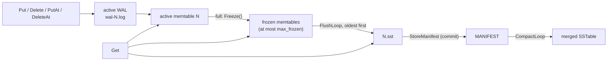

# RaftKV Storage Engine Design

| | |
|---|---|
| Scope | The per-node storage engine: WAL, memtables, flush, SSTables, manifest, compaction, recovery, checkpoints |
| Code | `src/storage/` (`kv_engine.{h,cpp}`, `wal.*`, `memtable.*`, `skiplist.h`, `sstable.*`, `bloom_filter.*`, `compaction.*`, `manifest.*`, `checkpoint.h`) |
| Tests | `tests/storage/` (engine: `kv_engine_lsm_test.cpp`, `kv_engine_flush_test.cpp`, `kv_engine_checkpoint_test.cpp`, `kv_engine_async_wal_test.cpp`, `kv_engine_applied_index_test.cpp`, `kv_engine_test.cpp`) |
| Related | `docs/sstable-format.md` (normative SSTable file format and compaction rules), `docs/raft-design.md` (how Raft drives the engine) |

This document describes what the code does today. Where a behaviour is a limitation rather than a
guarantee, it is listed in section 12. Section 13 lists statements in older documents that the
implementation has since superseded.

## 1. Overview and modes

`KVEngine` (`kv_engine.h`) implements `CheckpointableStore` (`checkpoint.h`), which extends
`IndexedKVStore` (`kv_store.h`): `Put`, `Get`, `Delete`, `PutAt` / `DeleteAt` (write plus the Raft
applied index), `AppliedIndex`, `Checkpoint` and `InstallCheckpoint`.

The engine has two modes, chosen by `Options::use_sstables`:

| Mode | Flush target | Manifest | Compaction | Used by |
|---|---|---|---|---|
| SSTable mode (`use_sstables = true`) | `NNNNNN.sst` written by the engine | `MANIFEST` | background thread | the node (`node_runtime.h`: `use_sstables = true` by default) |
| Legacy mode (`use_sstables = false`, the `Options` default) | `Options::flush_writer`, if set; otherwise nothing is ever frozen or flushed | none | none | older tests, the flush test seam, and the node with `--no-sstables` |

The two flush paths are mutually exclusive: `Open` returns `kInvalidArgument` if `use_sstables` and
`flush_writer` are both set. Everything below describes SSTable mode unless it says otherwise.



## 2. Files in the data directory

| Name | Written by | Meaning |
|---|---|---|
| `wal-NNNNNN.log` | `WAL` | one log per memtable; `N` is that memtable's sequence number |
| `NNNNNN.sst` | `SSTableBuilder` | an SSTable; live only if the manifest lists it |
| `NNNNNN.sst.tmp.XXXXXX` | `SSTableBuilder` | a table being written (published by `link`, never by overwrite; `sstable-format.md` §12.2) |
| `MANIFEST` | `StoreManifest` | the complete live state (section 5) |
| `MANIFEST.tmp` | `StoreManifest` | a manifest being written; renamed over `MANIFEST` |

WAL sequence numbers and SSTable file numbers come from **one counter** (`next_seq_`, persisted as
the manifest's `next_file_number`), so a number is never handed out twice (section 7, step 2). File names
are parsed by `ParseName` in `kv_engine.cpp` (at most 18 digits).

## 3. Write path

`KVEngine::Write` (shared by all four write calls) runs under `write_mu_`, which serialises writers so
that WAL order equals memtable order:

1. **Reserved keys.** `Put` / `Delete` / `PutAt` / `DeleteAt` reject keys with `kReservedKeyPrefix`
   (`kInvalidArgument`); the engine uses that prefix for its own `applied_index` key.
2. **Applied-index order.** `PutAt` / `DeleteAt` require `raft_index > AppliedIndex()` and
   `raft_index != 0`, else `kInvalidArgument` and nothing is written.
3. **Room.** `EnsureRoom` (section 4.1) may freeze the active memtable first, so the data record and
   its applied-index record always land in the **same** WAL and memtable.
4. **WAL first.** The record is appended to the active WAL (`WAL::AppendPut` / `AppendDelete`). With
   an index, the data record is appended without a sync, then the index record
   (`applied_index` = 8-byte little-endian `raft_index`) with one sync (if `sync_wal`). A crash can
   therefore lose the index record but never leave the index ahead of its data.
5. **Memtable second.** Only after the WAL append succeeded is the memtable updated (and
   `applied_index_` advanced). A write whose WAL append failed is not applied and returns
   `kIOError`.

**Durability.** With `sync_wal = true` (the `Options` default) every acknowledged write is fsynced
(`FullSync`: `fsync`, or `F_FULLFSYNC` on macOS). With `sync_wal = false` the record is written with
one `write()` but not fsynced; see section 10 for what recovery then guarantees.

**WAL record format** (`wal.h`): `[crc32:4][payload_len:4][payload]`, payload =
`[type:1][key_len:4][key][value]`, type 1 = put, 2 = delete; little endian; the CRC covers the
payload. After any failed write or fsync the `WAL` object refuses further appends (`failed_`), because
the file may end in a partial record that would hide later records.

**Memtable** (`memtable.h`, `skiplist.h`): a concurrent insert-only skip list. Readers take no lock;
an overwrite pushes a new version; a delete is a tombstone version. Nothing is freed until the
memtable is destroyed, so `ApproximateBytes()` only grows; `ShouldFlush()` is
`ApproximateBytes() >= memtable_bytes` (default 4 MiB).

## 4. Memtable freezing and flush

### 4.1 Freezing and back-pressure

`EnsureRoom` runs before every write:

- if the engine has stopped (`dead_`), the write fails with `kIOError`;
- if the active memtable is not full (or neither flush path is enabled), the write proceeds;
- if fewer than `max_frozen` (default 2) memtables are frozen, `Freeze()` runs;
- otherwise the writer waits on `cv_` for a flush to finish, **unless** the last flush attempt failed
  (`flush_failing_`) or the engine is stopping, in which case it fails fast with `kIOError`.

`Freeze()` first syncs the old WAL (so a frozen WAL is complete on disk even with `sync_wal = false`),
creates the next WAL `wal-(N+1).log` and syncs the directory, then moves the active memtable to the
front of `frozen_` and publishes a new read view. If creating the new WAL fails, nothing changes and
the write fails. If syncing the old WAL fails, that `WAL` refuses every later append (`failed_`), so
every later write fails until the engine is reopened.

### 4.2 Flush (`FlushLoop`, one background thread)

The flusher always takes the **oldest** frozen memtable, so SSTables appear in sequence order and
`flushed_through` only grows. For memtable `N`:

1. Outside the lock: write `N.sst` with all entries **including tombstones**
   (`WriteSSTable`, meta `{N, N, N}`), then open and validate it (`SSTable::Open`).
   Crash point `flush:after_sst`.
2. Under the lock, **commit**: `StoreManifest` with `N.sst` appended to the live list and
   `flushed_through = N`. Crash point `flush:after_manifest`.
3. Delete `wal-N.log` (failure is harmless: startup retires it, section 7).
4. Remove the memtable from `frozen_` and publish a view in which `N.sst` replaces it, in one step.

A memtable and its applied-index record therefore always go into the same SSTable. On failure the
memtable and its WAL are kept, `flush_failures` and `flush_failing` are set, and the flush is retried
after `flush_retry_ms` (default 200 ms). Failure of the manifest store is handled in section 8.3.

Before writing, a retry deletes a leftover `N.sst` from an earlier failed attempt, except when that
file was kept because a manifest may name it (section 8.3).

## 5. Manifest

`manifest.h` / `manifest.cpp`. The file `MANIFEST` always holds the **complete** state:

```
header   u64 magic "RKVMANI1" | u32 format_version (1) | u32 reserved (0)
records  repeated: u16 type | u16 flags | u32 payload_length | payload
trailer  u32 CRC-32 of every byte before it
```

| Type | Record | Payload |
|---|---|---|
| 1 | `next_file_number` | u64: highest file/WAL number ever handed out, plus one |
| 2 | `flushed_through` | u64: every WAL with sequence <= this is in a live or merged SSTable |
| 3 | `sstable` | u64 file_number, u64 min_seq, u64 max_seq (one per live file, oldest first) |

**Validation** (`DecodeManifest`): bad magic, bad checksum, truncation, a newer `format_version`, an
unknown record with flag bit 0 (`kManifestRequired`) set, a missing required record, duplicate file
numbers, overlapping or unordered ranges, `min_seq > max_seq`, or a file number
`>= next_file_number` are all `kCorruption`. An unknown record *without* the required flag is
skipped (forward compatibility).

**Storing** (`StoreManifest`): write `MANIFEST.tmp`, fsync it, `rename` it over `MANIFEST`, fsync the
directory. Because the whole state is replaced at once, any edit (a flush, a compaction replacing
several tables, a checkpoint replacing everything) is all-or-nothing.

`StoreManifest` returns `kIOError` both when it fails **before** the rename (the old manifest is
untouched) and when the **directory fsync after the rename** fails (the new manifest is already in
place but not known to be durable, so after a crash either may be found). Callers must not assume
which; section 8 describes how each caller handles it.

`LoadManifest` reports a missing manifest as `found = false` with `kOk` (a fresh directory). A
manifest that exists but cannot be opened is `kIOError`; one that fails to decode returns the
`DecodeManifest` status, `kCorruption` for a damaged manifest, never "empty". The existence check
(`std::filesystem::exists(path, ec)`) does inspect `ec`: a filesystem error during that check (for
example a symlink loop) is `kIOError`, never a missing manifest.

Every manifest store happens while holding `write_mu_` (the flush and compaction commits, and
`InstallCheckpoint`), so there is never more than one store in progress. This is what
`ManifestMayName` (section 8) relies on.

## 6. Read path

`KVEngine::Get` takes no engine lock. It copies a `shared_ptr` to an immutable `View` under the tiny
`view_mu_` and searches, newest data first:

1. the active memtable;
2. the frozen memtables, newest first;
3. the live SSTables, newest first (by `max_seq`).

The first layer that knows the key decides: a value is returned; a **tombstone stops the search** and
returns `kNotFound`. In an SSTable, the Bloom filter can only answer "absent"; otherwise the index
locates the one candidate block (`sstable-format.md` §11.2). A damaged block is reported as
`kCorruption` (or `kIOError`), **never** as "not found".

A reader keeps every `SSTable` in its view open (`shared_ptr`), so compaction can delete input files
while a reader still uses them. A `View` is replaced, never modified, so a reader never sees a
half-applied flush or compaction (tested by `LsmTest.ReadersNeverSeeTheStateGoBackwardsWhileFlushingAndCompacting`).

After the checkpoint fail-stop (section 11) every `Get` started afterwards returns `kIOError`.

## 7. Recovery (`Open` → `Recover`)

1. **Manifest and cleanup** (`LoadLsmState`):
   - load the manifest;
   - delete every directory entry whose name contains `.tmp` (unfinished writes, including
     `MANIFEST.tmp`), and every `NNNNNN.sst` the manifest does not list (an orphan of an uncommitted
     flush or compaction, or an input a committed compaction had not yet deleted);
   - if there is **no** manifest but there are SSTables, every such SSTable's WAL must still exist
     (the first flush's manifest store comes before its WAL is deleted, so this is the only crash
     that can leave it). If one is missing, open fails with `kCorruption` rather than guessing;
   - open every listed SSTable and check its footer range against the manifest. A missing,
     unreadable or mismatched table is `kCorruption`; **nothing is skipped**.
2. **Counter.** `next_seq_ = max(highest WAL or SSTable number on disk, orphans included,
   next_file_number - 1) + 1`.
3. **WALs**, oldest first:
   - a WAL with sequence `<= flushed_through` is already in an SSTable: it is deleted, never
     replayed;
   - every other WAL is replayed into its own memtable (`WAL::Replay`, which truncates a torn tail);
     a WAL damaged in the middle fails open with `kCorruption` unless `wal_truncate_on_corruption`
     is set (section 10).
4. The newest replayed WAL becomes the active memtable and keeps receiving writes; older ones are
   frozen and flushed again; empty older ones are deleted. If no WAL needs replay, a fresh active WAL
   is created.
5. `PublishView`, then the applied index is read through `Get` (the reserved key), so it is found in
   whichever layer holds it, including an SSTable after its WAL was retired. A missing key means no
   index has been persisted and leaves the applied index at 0. A malformed value returns
   `kCorruption`; any other read error is propagated and opening fails.

The crash walkthroughs are tested by the `LsmTest.ACrash*` tests (flush: before and after the
manifest store; compaction: after the output and after the manifest store; ambiguous manifest stores),
`LsmTest.LeftoverOrphansAndTempFilesAreCleanedAtStartup`,
`LsmTest.DamagedOrMissingStateIsReportedNeverTreatedAsEmpty` and
`LsmTest.SstablesWithoutAManifestAreRefusedRatherThanGuessedAbout`.

## 8. Compaction

### 8.1 Trigger and policy

`CompactLoop` (one background thread, started only if `compaction_trigger > 0`) waits until at least
`max(2, compaction_trigger)` SSTables are live (default 4; `0` = never). It then merges the **smallest
run of the newest tables** whose combined size is no larger than the table just older than the run,
or all tables if no such run exists (`NewestRunToCompact`). Table "size" is currently the SSTable's
**entry count** (`entry_count()`, at least 1), not its byte size (section 12).

The run is always contiguous, as `ValidateCompaction` requires (rule C5; it checks all of C1–C7,
`sstable-format.md` §13.2), and by this policy it always ends at the newest table. Each compaction
removes at least one table, so the loop cannot spin; it stops when fewer tables than the trigger
remain.

### 8.2 Installation and safe deletion

1. Under the lock: pick the run, snapshot the live list, take an output number from the shared
   counter and remember the engine epoch (section 9).
2. Outside the lock: `Compact` merges the inputs (k-way merge; the newest version of each key wins;
   §13.4) and publishes the output; open it. Crash point `compact:after_output`.
3. Under the lock: after a checkpoint fail-stop, stop without changing anything; if the epoch
   changed, delete the output and go back to waiting (it belongs to a replaced dataset). Check that
   the run is still at the same position (flushes only append, but this is checked, not assumed).
4. **Commit**: `StoreManifest` with the run replaced by the output in the same position. Then update
   the in-memory live list and publish a view. Crash point `compact:after_manifest`.
5. Outside the lock: delete the input files (readers holding them keep reading).

**Tombstones** are written to the output unless the run starts at the **oldest** live table
(`drop_tombstones = first == 0`, rule C7). Only then can nothing older exist for a tombstone to hide,
so the tombstone and every older version of its key are dropped. A run that does not include the
oldest table always keeps its tombstones. This is also why flush keeps tombstones in `N.sst`.

**Failures** leave the in-memory live set and the read view unchanged, never delete an input, and
count `compaction_failures`; the compaction is retried after `flush_retry_ms`.

- Merge, publication or open failed: the output is deleted (no manifest refers to it).
- **Manifest store failed**: the output is deleted only if `ManifestMayName` shows that the
  `MANIFEST` now in the directory does not list it (then the rename never happened). If it lists the
  output, or cannot be read, the output is **kept** in a list of unsettled outputs. Either manifest
  may survive a crash: with the new one the output is live and the inputs are orphans; with the old
  one the inputs are live and the output is an orphan. Startup deletes the orphans. Kept outputs are
  deleted after the next successful compaction store, whose manifest (built from the in-memory state)
  names none of them.

### 8.3 Flush and checkpoint manifest failures

The same rule protects the other two manifest stores:

- **Flush.** If the flush's store fails and `ManifestMayName` says the directory manifest lists
  `N.sst`, the table is kept (with the memtable and WAL) and the **retry reuses that file** instead
  of deleting and rewriting it. With the new manifest, recovery retires the WAL and uses the table;
  with the old one, the table is an orphan and the WAL is replayed.
- **Checkpoint install.** See section 9.2.

The failure after the rename is injected in tests through the test-only `fail_after_rename` argument
of `StoreManifest` (hook points `compact:`, `flush:` and `install:fail_after_manifest_rename` of
`Options::test_crash_hook`); see the `LsmTest.*Ambiguous*` and `ManifestTest.AFailureAfterTheRename*`
tests.

## 9. Checkpoints (Raft snapshots)

`KVStateMachine` (`src/server/kv_state_machine.h`) uses these for Raft snapshots; a failure there is
fatal to the node (`MustSucceed` aborts).

### 9.1 `Checkpoint`

Works in both modes. Under `write_mu_` it copies the active memtable and the current view and reads
the applied index, so the copy and the index describe the same instant. It then merges every layer
(newest version wins) **outside** the lock and emits only live keys: tombstones and the reserved keys
are left out (`checkpoint.h` format: `u64 count`, then `u32 klen | key | u32 vlen | value`). A damaged
SSTable block fails the checkpoint.

### 9.2 `InstallCheckpoint`

SSTable mode only (`kInvalidArgument` otherwise). Parsing happens before the lock is taken; the rest
runs under `write_mu_`:

1. parse the data (`kCorruption` if malformed);
2. write one new SSTable holding every key plus the applied index (crash point `install:after_sst`);
3. create a new empty WAL;
4. **commit**: `StoreManifest` with **only** the new table, `flushed_through` above every old WAL;
   crash point `install:after_manifest`;
5. switch the in-memory state, bump the **epoch**, publish a view, delete the old WALs and SSTables.

A flush or compaction that was running notices the epoch change when it takes the lock again and
discards its result (tested by `InstallCheckpoint.WinsOverFlushesAndCompactionsThatAreRunning` and
`LsmTest.ACompactionOverlappingACheckpointInstallIsDiscarded`).

**If the manifest store fails** the new WAL is deleted, and:

- if `ManifestMayName` shows that no manifest names the new table, it is deleted;
- otherwise the engine **stores the current (old) state again**, so the old dataset is durable before
  returning. Without this, the install's manifest could survive a crash and its `flushed_through`
  would retire WALs holding writes accepted after the failed install. If that restore succeeds, the
  new table is deleted;
- if the restore **also** fails, the new table is kept (either dataset can be recovered) and the
  engine **fail-stops** (section 11).

In every failure case `InstallCheckpoint` returns an error and the in-memory dataset is unchanged.

## 10. Asynchronous WAL (`sync_wal = false`)

The node runs the engine with `sync_wal = false` by default (`node_runtime.cpp`: `sync_wal = sync &&
sync_engine_wal`, `sync_engine_wal = false`): the Raft log is durable, and the engine can be rebuilt
from it. A power loss can then leave a **hole in the middle** of an unsynced WAL.

`Options::wal_truncate_on_corruption` (the node sets it unless `--sync-engine-wal` is given:
`wal_truncate_on_corruption = !sync_engine_wal`) makes recovery cut such a WAL at the first damaged
record, like a torn tail (`WAL::Replay(..., truncate_mid_log_corruption)`). If a WAL that lost data
is **not** the newest one, **every newer WAL is deleted**: data after a hole must not survive, or the
applied index could claim entries whose data was lost. The applied index then lags, and Raft replay
refills the gap.

Without the option (the `Options` default), a damaged middle is reported as `kCorruption` and open
fails. Tests: `WalReplay.*` and `AsyncWalEngine.*` in `kv_engine_async_wal_test.cpp`.

## 11. Fail-stop

The engine has a permanent stopped state (`dead_`), entered:

- when a test crash point fires (simulating a process death); or
- when `InstallCheckpoint`'s manifest store **and** its restore both fail, so it is unknown which
  dataset is durable (`fail_stopped_` is set as well).

After either, every write that passes its argument checks (`kIOError`, nothing reaches the WAL),
`Checkpoint` and `InstallCheckpoint` fail, and the background threads exit when they next wait. After
the **checkpoint fail-stop** only:

- every `Get` started afterwards returns `kIOError` (one already running may still return what it
  found);
- a flush or compaction already running stores no manifest when it resumes;
- `GetStats().fail_stopped` is `true`.

After a test crash point, reads and work already in progress behave as they always have (the crash
tests depend on that). The stopped state lasts until the directory is reopened, which recovers
whichever dataset is on disk. Tested by
`LsmTest.ACheckpointInstallWhoseStoreAndRestoreBothFailStopsTheEngine`.

## 12. Known limitations (confirmed in the current code)

- **Compaction sizing uses entry counts**, not bytes (`kv_engine.cpp`, `CompactLoop`), so tables with
  very different value sizes are weighed by count.
- **Point reads decode the whole candidate block** into a vector of entries before searching it
  (`SSTable::Get`, `SSTable::ReadBlock`). The v1 block format has no record-offset table, so a true
  binary search inside a block would need a format change.
- **No block cache, no range scan.** Every block read goes to the file (`pread`). There is no
  `Seek` on `SSTable::Iterator` and no engine `Scan`.
- **Kept files are cleaned up late.** After an ambiguous manifest store, a kept compaction output is
  deleted at the next successful compaction or restart, and a kept checkpoint table at restart.
- **A damaged length field in the middle of a strict-mode WAL** is treated as a torn tail and the
  rest of the log is truncated instead of reported (`WAL::Replay` ends the scan on a length below 5,
  above `kMaxPayloadBytes` or past the end of the file, and on a checksum-valid record with a bad type,
  a bad key length, or a delete that carries a value). Telling these apart from a torn tail would
  need a WAL format change.
- **Startup cleanup matches `.tmp` anywhere in a name** (`LoadLsmState`), so any file in the data
  directory whose name contains `.tmp` is deleted. The directory is assumed to belong to the engine.
- **No data-directory lock.** Nothing stops two engines from opening the same directory; the
  single-writer assumption behind `ManifestMayName` relies on that not happening.
- **`ManifestMayName` reads the manifest while holding `write_mu_`**, but only on a failure path.
- **The checkpoint fail-stop is permanent** until reopen, and `AppliedIndex()` still returns the last
  in-memory value (it cannot report an error).
- **One flusher and one compactor.** Writers block (or fail fast while flushing fails) once
  `max_frozen` memtables are waiting.

## 13. Older statements superseded by the implementation

These documents are not changed by this one; they are listed so readers know which text to trust:

- `docs/sstable-format.md` Appendix A.3–A.4 recommends an **append-only** manifest log of edits.
  The implementation replaces the **whole** manifest atomically (section 5).
- `docs/raft-design.md` ("Limitations and future work") records the engine checkpoint and the
  persisted applied index as done.
  Both exist: `Checkpoint` / `InstallCheckpoint` (section 9), and the applied index is an ordinary
  reserved key written with every `PutAt` / `DeleteAt` (section 3) as a second record after the data
  record. On replay after a restart, `KVStateMachine` skips the store writes for entries at or below
  the index the engine reports, but still replays their client-session effects.
